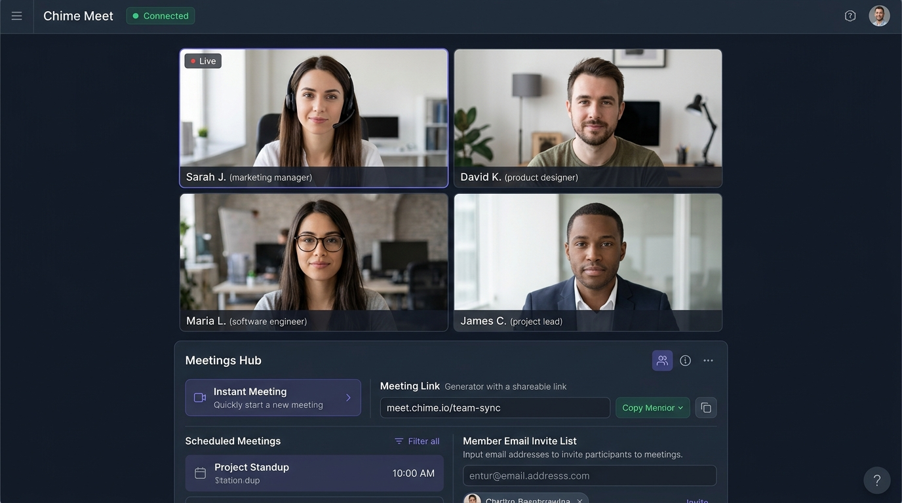

# Chime Meet — Small-Group Video Conferencing Workspace



A modern, single-page React + TypeScript web application built with **Vite**, **Tailwind CSS**, and the **Amazon Chime SDK for JavaScript (`amazon-chime-sdk-js`)**. It enables instant small-group video meetings (up to 4 simultaneous video tiles), Google Meet / Microsoft Teams-style shareable meeting link generation, multi-meeting scheduling, and automated email invitations via an AWS Lambda backend.

---

## Key Features & Functionality

### 1. Unified Meetings Hub
- **Start Instant Meeting**: Generates a unique meeting room code (`abc-defg-hij`) and immediately launches the live video room in a single click.
- **Join via Meeting Link or Code**: Paste either a full meeting link (`https://.../?room=abc-defg-hij`) or a room code (`abc-defg-hij`) to extract the room identifier and connect right away.
- **Auto-Join from Shared Links (`?room=...`)**: Opening a shared meeting URL with a `?room=` query parameter automatically populates the room code, switches to the Meeting Room stage, and initiates the Amazon Chime session.
- **Create & Schedule Multiple Meetings**:
  - Create multiple simultaneous meeting rooms, each with a custom **Meeting Title**, optional **Scheduled Date & Time**, and auto-generated **Meeting Link**.
  - Add multiple **Member Emails** when creating a meeting (or add more members later) and send email invitations in bulk.
  - View per-member invite delivery statuses (`Invite sent`, `Sending...`, or `Failed`).
  - Switch between active rooms or copy shareable links for any scheduled meeting.

### 2. Real-Time Audio & Video Conferencing (Amazon Chime SDK)
- **Responsive Video Grid (Up to 4 Participants)**:
  - Displays your local camera tile (muted locally to prevent echo, labeled `"You"`) alongside up to 3 remote attendee video tiles.
  - Video tiles are dynamically created when `videoTileDidUpdate` fires and automatically removed when `videoTileWasRemoved` triggers or a participant leaves.
- **Real-Time Attendee Presence**:
  - Uses `realtimeSubscribeToAttendeeIdPresence` to show a live roster of connected participants in the room—even if a participant joins with their camera turned off.
- **Live Media Controls**:
  - **Mute / Unmute Microphone**: Instant real-time audio muting via `realtimeMuteLocalAudio()` and `realtimeUnmuteLocalAudio()`.
  - **Camera On / Off**: Dynamically starts and stops the local video input device and video tile (`startVideoInput` / `startLocalVideoTile` and `stopLocalVideoTile` / `stopVideoInput`).
  - **Leave Meeting**: Cleanly stops local media streams, unbinds audio/video elements, and disconnects from the Chime session.
- **Connection Telemetry & Error Diagnostics**:
  - Live status indicator (`Idle`, `Joining`, `Connected`, `Error`) and short AWS Chime `MeetingId` badge.
  - Full-text error alert banner that surfaces raw backend errors or device permission issues clearly.

---

## How It Works (Architecture & Flow)

```text
┌──────────────────────────┐        POST JSON         ┌──────────────────────────────────┐
│   React SPA Frontend     │ ───────────────────────► │      AWS Lambda Function URL     │
│  (Vite + Chime SDK JS)   │ ◄─────────────────────── │ (Creates/Joins Chime Meetings &  │
└────────────┬─────────────┘   { Meeting, Attendee }  │      Sends Email Invites)        │
             │                                        └──────────────────────────────────┘
             │ WebRTC Signaling & Media
             ▼
┌──────────────────────────┐
│   AWS Chime Media &      │
│   Signaling Servers      │
└──────────────────────────┘
```

### Step-by-Step Meeting Lifecycle

1. **Creating / Joining a Room (`POST` to AWS Lambda)**:
   - When a user joins a room, the frontend sends a `POST` request to the AWS Lambda Function URL with:
     ```json
     {
       "room": "<room-code>",
       "user": "<display-name>"
     }
     ```
   - The Lambda backend either creates a new Amazon Chime meeting for that `room` or looks up the existing active Chime meeting, creates an attendee token, and responds with:
     ```json
     {
       "Meeting": { ... },
       "Attendee": { ... }
     }
     ```

2. **Initializing `DefaultMeetingSession`**:
   - The app requests browser camera and microphone permissions (`navigator.mediaDevices.getUserMedia`) so device enumeration receives valid hardware IDs.
   - It initializes `ConsoleLogger`, `MeetingSessionConfiguration(Meeting, Attendee)`, `DefaultDeviceController`, and `DefaultMeetingSession` from `amazon-chime-sdk-js`.

3. **Binding Devices & Starting Media**:
   - Enumerates audio and video input devices via `audioVideo.listAudioInputDevices()` and `audioVideo.listVideoInputDevices()`.
   - Starts the primary microphone (`startAudioInput`) and camera (`startVideoInput`), and binds remote meeting audio to a hidden `<audio autoPlay playsInline>` DOM element (`bindAudioElement`).

4. **Observing Video Tiles & Presence**:
   - Registers an `AudioVideoObserver`:
     - `audioVideoDidStart`: Transitions status to `Connected` and starts broadcasting the local video tile (`startLocalVideoTile()`).
     - `videoTileDidUpdate`: Binds each active `tileId` to its corresponding `<video>` element in the React grid using `audioVideo.bindVideoElement(tileId, videoElement)`.
     - `videoTileWasRemoved`: Unbinds and removes the tile from the UI state immediately.
     - `audioVideoDidStop`: Cleans up media tracks and resets session state.

5. **Sending Email Invitations**:
   - Clicking **Send invite** (or **Create & Send Link**) sends a `POST` request to the same Lambda endpoint:
     ```json
     {
       "action": "invite",
       "email": "colleague@example.com",
       "room": "<room-code>",
       "fromName": "<display-name>"
     }
     ```
   - The backend dispatches the invitation email containing the `?room=<room-code>` link and returns `{"ok": true}` (or `{"error": "..."}` on failure).

---

## Tech Stack

- **Frontend Framework**: React 19, TypeScript, Vite
- **Real-Time WebRTC SDK**: `amazon-chime-sdk-js`
- **Styling & Icons**: Tailwind CSS v4, `lucide-react`
- **Backend**: Serverless AWS Lambda Function URL + Amazon Chime Meetings API + Email Invite Service

---

## Getting Started Locally

1. **Install dependencies**:
   ```bash
   npm install
   ```

2. **Start the development server**:
   ```bash
   npm run dev
   ```
   The app will start on `http://localhost:3000`.

3. **Build for production**:
   ```bash
   npm run build
   ```
